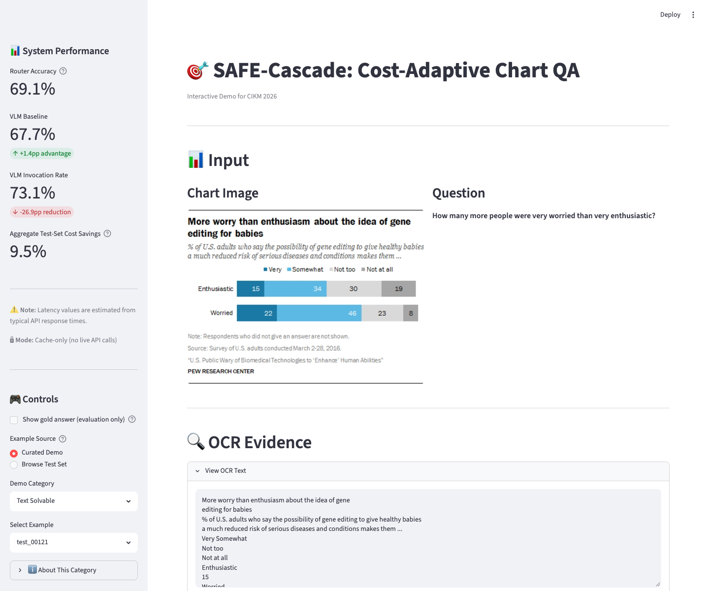

# SAFE-Cascade: ACM CIKM Demo

An interactive Streamlit demonstration of SAFE-Cascade, a cost-adaptive routing approach for chart question answering. The demo shows how a router chooses between a cached text-only answer and a cached vision-language-model (VLM) answer as the confidence threshold changes.



**Live demo:** <https://safe-cascade-demo-23705222796.us-central1.run.app>

## Demo at a glance

- Browse curated text-solvable, VLM-needed, and borderline examples.
- Inspect the chart, question, OCR evidence, cached predictions, and router decision.
- Adjust the routing threshold and view the cost/accuracy operating frontier.
- Uses precomputed results only. **No live model or OCR API calls are made.**

## Run locally

Requirements: Python 3.10 or newer.

```bash
git clone <repository-url>
cd safe-cascade-demo
python3 -m venv .venv
source .venv/bin/activate       # Windows: .venv\\Scripts\\activate
python -m pip install --upgrade pip
python -m pip install -r requirements.txt
python -m streamlit run app_safe_cascade_demo.py
```

Open the local URL printed by Streamlit, usually <http://localhost:8501>.

To run the smoke tests in a second terminal with the virtual environment activated:

```bash
python test_demo.py
```

## Project layout

```text
app_safe_cascade_demo.py             Streamlit application
src/safe_cascade_demo/               UI, routing, example, and data-loader modules
safe_cascade/data/                   Minimal cached data required by this demo
ChartQA-extracted/test/              Chart images for the 375 test examples
screenshots/                         UI screenshot shown above
test_demo.py                         Smoke tests
requirements.txt                     Python runtime dependencies
```

The cached artifacts contain the 2,500-example experiment dataset and precomputed text/VLM predictions, plus router predictions and threshold-result tables. The app loads these files locally; it does not need model credentials.

## Validation

The project smoke test verifies imports, cached-data loading, example composition, routing behavior, curated examples, and that live APIs are disabled:

```bash
python test_demo.py
```

## Research and data note

This repository is the conference-demo UI package, not the separate SAFE-Cascade journal workspace. It includes a subset of cached ChartQA experiment outputs and test-set chart images so the demo can run without external data downloads. The included files are for demonstrating the research results; consult the applicable dataset and model-provider terms before redistributing them separately.
